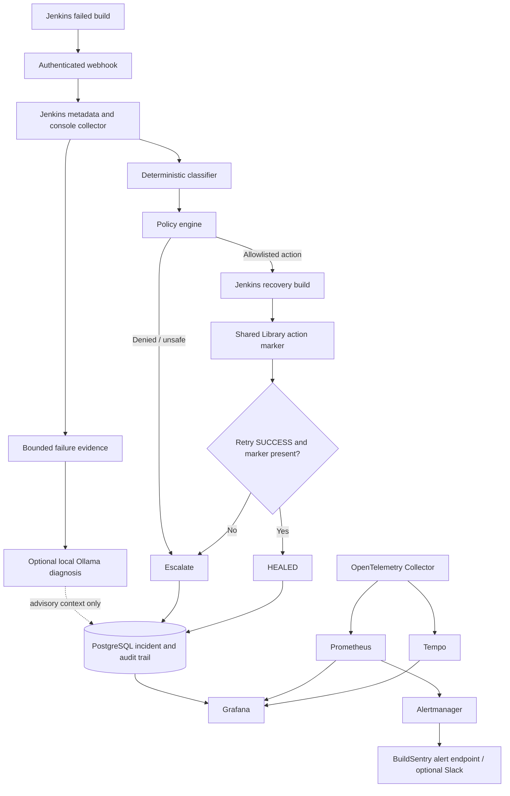

# BuildSentry AI Platform

**A policy-gated Jenkins failure analysis and recovery prototype.** BuildSentry combines deterministic failure classification, optional local AI-assisted diagnosis, explicit remediation policy, Jenkins recovery builds, PostgreSQL audit records, and an observability stack.

## What it does

1. A Jenkins pipeline sends a signed-by-shared-secret failure notification to `POST /webhook/jenkins`.
2. BuildSentry validates the secret, retrieves the failed build metadata and console log from Jenkins, and extracts bounded failure evidence.
3. Deterministic rules select the failure category. Optional Ollama analysis provides additional diagnostic context; AI does **not** choose or authorize remediation.
4. The policy engine permits only explicitly allowlisted, low-risk recovery actions. Unsupported, unknown, and unsafe failures are escalated.
5. BuildSentry triggers a separate Jenkins build with an internal action parameter.
6. The Jenkins Shared Library performs the configured action at its matching pipeline stage and writes an action-execution marker into the Jenkins build description only after the action returns successfully.
7. BuildSentry marks an incident `HEALED` only when the retry result is `SUCCESS` **and** the expected action marker is present. A passing retry without the marker is escalated as `ACTION_NOT_CONFIRMED`.
8. PostgreSQL stores incidents and audit events; Grafana, Prometheus, OpenTelemetry, Tempo, and Alertmanager provide observability. Slack notifications are optional.

## Architecture



### Safety boundary

- Deterministic classification and policy—not the language model—control recovery eligibility.
- AI diagnosis is advisory. AI output cannot grant permission to remediate.
- Recovery operations are allowlisted and limited to one recovery build per incident.
- A retry being accepted by Jenkins is not success. The backend waits for a terminal result and verifies the action marker.
- BuildSentry does not automatically rewrite application code, repair credentials, restart a broken Docker daemon, or perform unrestricted host cleanup.

## Supported recovery policy

| Failure category | Policy / action | Boundary |
|---|---|---|
| `FLAKY_TEST` | One controlled retry | A retry only; no test code is changed |
| `NETWORK_FAILURE` | Bounded connectivity check and backoff, then retry | Does not change DNS, credentials, or registry settings |
| `WORKSPACE_FAILURE` | Clean the job workspace and retry | Requires the checkout hook before `checkout scm` |
| `DEPENDENCY_FAILURE` | Recreate a supported dependency environment from its manifest, then retry | Does not intentionally upgrade lockfiles or versions |
| `DOCKER_FAILURE` | Docker daemon preflight and scoped `docker build --no-cache`, then retry | Jenkinsfile must consume `BUILDSENTRY_DOCKER_NO_CACHE`; no global cache prune |
| `REGISTRY_FAILURE` | One controlled retry | Authentication failures should be classified/escalated separately |
| `CODE_FAILURE` | Deny automatic remediation | Human fixes code/tests |
| `UNKNOWN`, disk/resource/agent/authentication safety cases | Escalate | No automatic privileged repair |

Exact signatures and eligibility are defined in `app/classifier/rules.py` and `app/policy/rules.py`. Review these files before adding new recovery behavior.

## Technology

- Python 3.12, FastAPI, Pydantic Settings
- Jenkins REST API and Jenkins Shared Library (Groovy)
- PostgreSQL and SQLAlchemy
- Optional local Ollama model for diagnosis
- Docker Compose
- OpenTelemetry Collector, Prometheus, Grafana, Tempo, Alertmanager
- pytest / pytest-asyncio

## Prerequisites

- Docker Engine and Docker Compose v2
- Python 3.12 for local tests
- A Jenkins controller reachable from the API container
- A Jenkins API user/token with permission to read build metadata/console output and trigger builds
- A Jenkins Secret Text credential named `autoheal-webhook-secret` whose value matches `WEBHOOK_SECRET` in `.env`
- A Jenkins global Shared Library named `BuildSentry` pointing to this repository (or the directory containing `jenkins-shared-library/vars/buildsentry.groovy`)
- A local Ollama model only if AI diagnosis is enabled

## Quick start

### 1. Configure secrets

```bash
cp .env.example .env
```

Edit `.env`. Replace every `replace-with-...` value, set the Jenkins URL/username/API token, and keep `DATABASE_URL` consistent with `POSTGRES_USER`, `POSTGRES_PASSWORD`, and `POSTGRES_DB`. For the example connection URL, use a URL-safe password (for example, a hexadecimal random value) or URL-encode special characters in the URL.

Generate unique URL-safe values with `openssl rand -hex 24` if OpenSSL is available. Do not reuse the example values and never commit `.env`.

Create the ignored Alertmanager secret file from the configured value:

```bash
python scripts/setup-local-secrets.py
```

The script writes `.secrets/alertmanager_secret` with restrictive permissions and does not print the secret. The file is git-ignored. Alertmanager uses it to authenticate requests to BuildSentry; the file must exist before Compose starts.

### 2. Start the stack

```bash
docker compose config
docker compose up --build -d
docker compose ps
```

Check health and interfaces:

- API health: <http://localhost:8000/health>
- Grafana: <http://localhost:3000>
- Prometheus: <http://localhost:9090>
- Alertmanager: <http://localhost:9093>
- Tempo: <http://localhost:3200>

Use the Grafana username/password set in `.env`. The default username is `admin`; set a unique password before starting the stack.

### 3. Pull the local AI model (optional)

Compose starts Ollama but does not download model weights automatically:

```bash
docker exec autoheal-ollama ollama pull llama3.2:3b
docker exec autoheal-ollama ollama list
```

Set `AI_ENABLED=true` and `OLLAMA_MODEL=llama3.2:3b` in `.env` to enable local AI diagnosis. If AI is disabled or unavailable, deterministic classification and policy remain authoritative. Ollama is configured for CPU by default. Optional NVIDIA support is available with:

```bash
docker compose -f docker-compose.yml -f docker-compose.gpu.yml up --build -d
```

The GPU override requires a working NVIDIA Container Toolkit/runtime and may fail on hosts without it.

### 4. Verify services

```bash
docker compose logs --tail=100 autoheal
docker compose logs --tail=100 prometheus
docker compose logs --tail=100 alertmanager
```

Open Prometheus **Status → Targets** and verify that `otel-collector` is up. Open **Status → Rules** to confirm the AutoHeal alert rules loaded. Do not assume that syntactically valid YAML means a service started successfully.

## Jenkins integration

The library entrypoint is `jenkins-shared-library/vars/buildsentry.groovy`. Configure the library in Jenkins and use the example at `jenkins/BuildSentryRemediation.example.groovy` as a starting point, adapting build/test commands to your repository.

The library needs stage hooks at the point where the action can safely run:

```groovy
buildsentry(stage: 'checkout') // before checkout scm
buildsentry(stage: 'test')     // before dependency setup/tests
buildsentry(stage: 'docker')   // before Docker build
buildsentry(stage: 'registry') // before registry push
```

A stage-bound action called from the wrong stage is not executed. The action marker is deliberately absent in that case, so BuildSentry will escalate even if the retry build later passes. For Docker cache recovery, the pipeline must use `BUILDSENTRY_DOCKER_NO_CACHE` to add `--no-cache` to the relevant build command. Registry pushes require your own Jenkins credentials and registry configuration; do not hard-code credentials in a Jenkinsfile.

The pipeline's `post { failure { ... } }` block should call `buildsentry()` to notify the backend. Configure the Jenkins Secret Text credential `autoheal-webhook-secret` to match `.env` `WEBHOOK_SECRET`. The backend accepts `X-BuildSentry-Secret` and the legacy `X-AutoHeal-Secret` header.

### Failure-injection validation

Use a disposable Jenkins job/agent and a non-production registry. For each test, retain the original failed build, recovery build, BuildSentry incident/audit trail, and terminal result. Validate at least:

1. `DEPENDENCY_FAILURE`: remove a test dependency; confirm the dependency hook executes, action marker is written, and retry succeeds.
2. `WORKSPACE_FAILURE`: inject a workspace-only fault; confirm cleanup occurs before checkout and retry succeeds.
3. `NETWORK_FAILURE`: inject a controlled transient connectivity failure; confirm bounded check/backoff and retry.
4. `DOCKER_FAILURE`: confirm the retry build consumes `BUILDSENTRY_DOCKER_NO_CACHE` and actually invokes `docker build --no-cache`.
5. `CODE_FAILURE` and `UNKNOWN`: confirm no automatic recovery is triggered and the incident is escalated.
6. Missing hook: allow the retry to pass without the expected hook; confirm the final result is `ACTION_NOT_CONFIRMED`, not `HEALED`.
7. Authentication mismatch: confirm a bad webhook secret returns HTTP 401 and creates no incident.

Never report healing success from HTTP 202 alone. HTTP 202 only means the failure notification was accepted for asynchronous processing.

## Local tests

```bash
python -m venv .venv
# Linux/macOS:
source .venv/bin/activate
# Windows PowerShell: .venv\Scripts\Activate.ps1
python -m pip install -r requirements.txt
python -m compileall -q app tests
pytest -q
```

The automated tests use an isolated SQLite database and mock external Jenkins calls. They do not replace a live Jenkins/Groovy/Docker/Prometheus/Alertmanager validation. With the checked-in test environment, the current suite passes **69 tests** in the local audit environment.

## Observability

- The API exports application metrics and traces through the OpenTelemetry Collector when `OTEL_ENABLED=true`.
- Set `OTEL_ENABLED=false` for offline/local unit tests; this disables OTLP exporters and FastAPI request instrumentation.
- Prometheus scrapes the Collector's metrics endpoint at `otel-collector:8889` and loads rules from `observability/prometheus/rules/`.
- Grafana is provisioned with Prometheus, Tempo, and PostgreSQL data sources plus the dashboard JSON under `observability/grafana/dashboards/`.
- Alertmanager authenticates to `/alerts/alertmanager` with the bearer secret stored in `.secrets/alertmanager_secret`.
- `SLACK_WEBHOOK_URL` is optional. If unset, no Slack message is delivered; verify delivery in your own environment before relying on alerts.

## Security notes

- Never commit `.env`, `.secrets/`, Jenkins API tokens, database passwords, or Slack webhook URLs.
- The API and observability ports bind to `127.0.0.1` on the host by default. Do not expose them publicly without authentication, TLS, and network controls.
- Rotate all credentials if they were ever committed or shared in logs/screenshots.
- A Jenkins agent with Docker socket access effectively has privileged access to the Docker host. Use a disposable agent for experiments, not a shared production controller.
- Log redaction is best-effort, not a guarantee that every possible secret format will be removed. Keep sensitive credentials out of console output.
- Review Trivy findings rather than suppressing them just to obtain a green pipeline; vulnerability counts change with scanner databases and base images.

## Known limitations

- FastAPI `BackgroundTasks` is in-process and not durable. A process crash after HTTP 202 can interrupt processing. A durable queue is a future reliability improvement, not implemented here.
- The circuit breaker is in memory and resets on process restart; it is not a distributed lock.
- The Jenkins action marker verifies that the Shared Library reached the post-action marker and the retry passed. It is not cryptographic proof of every side effect inside arbitrary user pipeline code; integration tests and restricted library/job permissions remain important.
- The shared library only works when the correct stage hooks are installed and the Jenkins agent has the required tools and permissions.
- A successful unit test run does not establish production readiness. Test the full stack and each recovery path in a disposable environment.

## CI status

This ZIP does not include a GitHub Actions workflow. Run the local test commands above before pushing. A CI workflow can be added later, but it should not be described as existing until it is checked into the repository and its run is green.

## License

MIT. See [`LICENSE`](LICENSE).